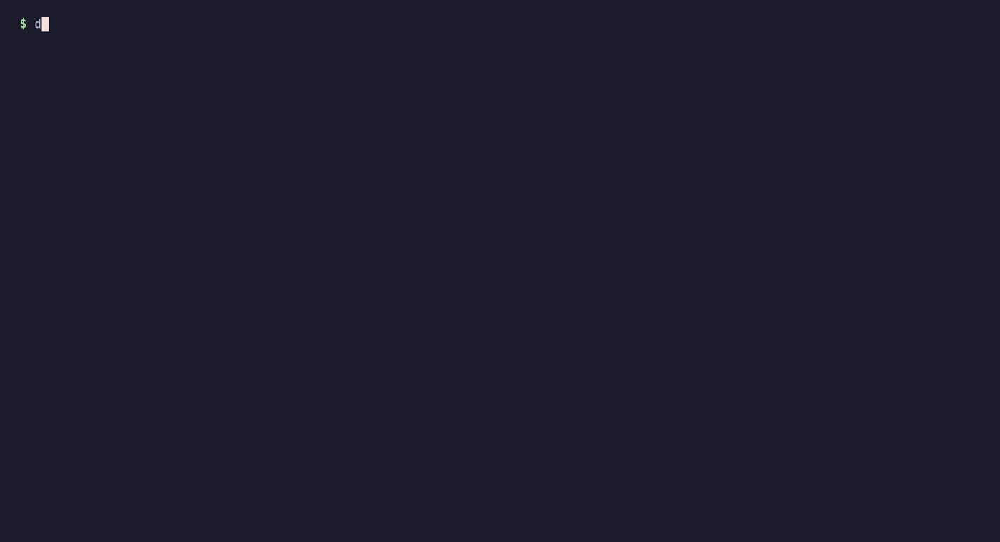

<p align="center">
  
</p>

<p align="center">
  <b>Package a small container stack once. Ship it signed to your OCI registry.<br>
  Install, upgrade, roll back and recover it on a Docker host, a Kubernetes cluster or a
  self-updating VM appliance — with one installer and one set of verbs.</b>
</p>

<p align="center">
  <a href="LICENSE"></a>
  <a href="CHANGELOG.md"></a>
  
  <a href="#packed-with-stowage"></a>
</p>

<p align="center">
  
  <br><sub>An operator installs <a href="examples/minimal">examples/minimal</a>: one bootstrap
  script, a form, a review screen, a running stack. Recorded with
  <a href="docs/demo/">docs/demo</a>.</sub>
</p>

Stowage is for the team that ships a product — typically one Postgres, a backend or two and a
web frontend behind TLS — to *other people's* infrastructure: a customer's server, their cluster,
their hypervisor, sometimes a site without internet. You describe the stack once, in a
`stowage.yaml` beside your compose file. Stowage turns it into signed, versioned releases in one
registry, and gives each operator an installer that asks a few questions, starts the stack fully
configured and keeps managing it afterwards.

Licence: Apache 2.0 · Design: [docs/DESIGN.md](docs/DESIGN.md) · Release notes:
[CHANGELOG.md](CHANGELOG.md) · Status: pre-1.0, [see below](#status).

## In thirty seconds

```bash
# The publisher: check the project, then build what changed, sign it and push it.
stowage -C notes lint
stowage -C notes ship

# The operator: fetch the installer, answer the form, get a running stack.
docker run --rm registry.example.com/notes/notes-installer > notes.sh
sh notes.sh

# Later, from the install, signed and reversible.
./notes/notes-stow upgrade --version 1.1.0
./notes/notes-stow rollback
```

## What it brings

- **One description, three deploy shapes.** The same images run under Docker Compose on one
  host, under Helm on Kubernetes (your chart, given the release's images by digest), and inside
  a Kairos VM appliance — an immutable OS image with A/B updates, built from your release and
  published as `qcow2`, `raw`, `ova`, `vhd` and `gce` disks.
- **The registry is the only way in.** Images, the chart, the OS bundle, the disks, the
  installer and a release manifest all live in one OCI registry under your prefix. Nothing
  reaches an operator any other way, and every install upgrades from there (or from a mirror).
- **Incremental, reproducible releases.** Every artifact has a content digest of exactly what
  can change it. `stowage ship` rebuilds only what changed, re-tags the rest, and re-running it
  publishes nothing new.
- **Signed end to end.** With a cosign key, every artifact is signed by digest before its tag
  moves. Installs carry your public keys and refuse an upgrade not signed by one of them.
- **An installer operators can run.** A terminal form with inline validation and a review
  screen — or, for automation, flags, environment variables or an answers file, with no
  terminal at all. It generates the secrets, puts a TLS front in place (ACME, Cloudflare DNS,
  your own certificate, a local CA, or plain loopback), runs your provision hook, and prints the
  portal URL.
- **Day-2 operations, not just day 1.** Re-running the installer reconfigures. `upgrade`,
  `rollback` (guarded by your schema's rollback barriers), `reset-db`, secret rotation without
  downtime, offline mirrors, and on the VM a health gate, encrypted backups and a host daemon.
- **Nothing project-specific in Stowage.** Everything that differs between projects — version
  scheme, changelog format, registry auth, health check, schema compatibility, backup — is a
  provider with built-in choices and a `command` escape hatch (JSON in, JSON out).

## The lifecycle, end to end

<p align="center">
  
</p>

| Stage | Who | What Stowage does |
|---|---|---|
| **Describe** | developer | `stowage.yaml` names the images, the compose file (the single service definition), the front's routes, the health check, the database, the volumes, the secrets to generate and the inputs to ask. `stowage lint` checks the whole project against the [contracts](docs/contracts.md) and names the `key` or `file:line` to fix. |
| **Version** | developer | The version comes from your changelog, a file, a git tag or a command; a scheme (CalVer, SemVer, regex, command) validates and orders it. Stowage never compares versions as strings. `stowage.lock` pins the Stowage that publishes. |
| **Publish** | developer, CI | `stowage ship` builds what changed, pushes it by digest, signs it, builds the installer and the release manifest, then moves the channel's pointer. `verify`, `promote` (beta → stable without rebuilding), `yank`, `prune`, `releases`. `stowage hook install` ships each version bump on commit. |
| **Install** | operator | `docker run --rm <prefix>/<name>-installer:latest > <name>.sh` gets the bootstrap script, which carries the installer, `<short>-stow`; then `sh <name>.sh` on Docker; `sh <name>.sh k8s install` on Kubernetes; `sh <name>.sh vm create` for a VM (seed ISO or cloud user-data, or the VM created with OpenTofu: TrueNAS; libvirt, Proxmox VE, vSphere, AWS, Google Cloud, Azure and Scaleway as previews; or a module of your own). Inputs asked once, secrets generated once, provision hook run, portal URL printed. |
| **Operate** | operator | `status`, a re-run to change inputs, ports or the TLS mode (the changes logged, the previous values kept), `provision`, `secrets rotate` (stage, swap, finish: the old value accepted meanwhile), `secrets set` (a chosen value for a `settable` secret), `secrets show` (a `settable` secret's value, on a terminal), `secrets export` (age-encrypted, to rebuild a machine), `reset-db`. |
| **Upgrade** | operator | `upgrade --version V` fetches that release's installer, checks its signature against the keys the install trusts and brings the stack up on the new images — on Docker after a `pg_dump` snapshot, on Kubernetes through Helm. `updates` says which release the channel offers after the one the install runs, signed by a key it trusts, with its changelog (or that there is none) — on Docker, on Kubernetes (`k8s updates`) and on the VM, where `upgrade` reboots into the new OS. |
| **Roll back** | operator | `rollback` returns to the previous release — unless a migration since then is a rollback barrier your schema-compat provider reports, in which case it refuses and names it. On the VM the health gate does it alone: an upgraded boot that is not healthy in time falls back to the previous system. |
| **Recover** | operator | On the VM: scheduled and pre-upgrade backups (`pg_dump` and the volumes the project lists, or those volumes alone for a project without a database, encrypted to age keys, uploaded with rclone to any rclone remote), `restore` into a side database swapped in once loaded whole, and a disaster recovery from exported secrets. |
| **Disconnected sites** | operator | `mirror export` carries a release, signatures included, as one file; `mirror import` loads it into a local registry; installs and upgrades then read the mirror (`--registry`, `--registry-ca`). |

### What each shape gets

| | Docker | Kubernetes | Kairos VM |
|---|---|---|---|
| Install with the terminal form or an answers file | ✓ | ✓ | ✓ (`vm create`, first boot) |
| TLS front (Caddy) built in | ✓ | — (your chart's ingress) | ✓ |
| Signed `upgrade` / `rollback` | ✓ | ✓ (Helm) | ✓ (A/B reboot) |
| Rollback refused past a schema barrier | ✓ | ✓ (`shapes.kubernetes.schema`) | ✓ |
| `reset-db`, `secrets rotate` | ✓ | ✓ | ✓ |
| `secrets set` | ✓ | — | ✓ |
| `secrets show` | ✓ | ✓ | ✓ |
| `secrets export` | ✓ | — | ✓ |
| Install from a mirror | ✓ | ✓ | ✓ |
| A failed upgrade undone on its own | — | ✓ (Helm `--wait`, rolled back when not ready) | ✓ (health gate) |
| Scheduled encrypted backups, `restore` | ✓ (systemd timer) | — | ✓ |
| Disk-pressure hook | ✓ (systemd timer) | — | ✓ |
| Host daemon, firewall, network change with auto-revert | — | — | ✓ |

### What it is not

- **Not a platform.** One install is one host (Docker, VM) or one Helm release. Stowage
  orchestrates nothing across hosts.
- **Not a chart generator.** On Kubernetes you bring your own chart; Stowage packages it and
  hands it the release's images, secrets and pull account.
- **Postgres only** for the database-aware features (snapshots, `reset-db`, schema barriers,
  backups) in this version.
- **Pre-1.0.** Released and used, but the first version targets parity with an existing
  production deployment of this kind on its three shapes; the spec format is `stowage/v1`, and
  until 1.0 a release may move or rename a key without an alias ([CHANGELOG.md](CHANGELOG.md)
  says which).

## Quick start

The full walk-through, from an empty directory to a release on every shape, is
[docs/guide.md](docs/guide.md). The shortest path, for a project like
[examples/minimal](examples/minimal/):

**Publish.** A project is a directory holding `stowage.yaml` beside its compose file. Pin the
Stowage that publishes, check, see what would be built, then build, sign and push:

```bash
stowage -C notes lock          # writes stowage.lock: commit it
stowage -C notes lint          # fix every error; warnings do not block
stowage -C notes plan          # the build graph and what a ship would build
stowage -C notes ship          # build what changed, push by digest, sign, move the channel's pointer
stowage -C notes verify        # the published release and its signatures
```

**Install on Docker.** The installer image prints a bootstrap script that carries the installer,
`<short>-stow`, and the release:

```bash
docker run --rm registry.example.com/notes/notes-installer:latest > notes.sh
sh notes.sh                                   # the form: TLS mode, domains, inputs, a review
sh notes.sh --no-input --tls internal \
   --domains app=notes.lan,api=api.notes.lan --set ADMIN_EMAIL=ops@example.com   # the same, unattended
./notes/notes-stow status
./notes/notes-stow updates          # the release the channel offers after this one
./notes/notes-stow upgrade --version 1.1.0
./notes/notes-stow rollback
```

**Install on Kubernetes** (a project with the `kubernetes` shape and its chart): `sh notes.sh k8s
install`, with the operator's `helm` (≥ 3.14) and `kubectl` on the current context.

**Create a VM** (a project with the `kairos` shape): `sh notes.sh vm create --platform truenas …`
makes the VM from the release's disk and seeds its first boot; `vm seed --json` gives that seed to
a tool that makes the VM itself. On the VM (as root or the `admin` group), `notes-stow status`,
`updates`, `upgrade`.

## Packed with Stowage

A project that ships with Stowage can say so in its README:
[](https://github.com/norvexlabs/stowage)

```markdown
[](https://github.com/norvexlabs/stowage)
```

The logo ([`docs/img/logo.svg`](docs/img/logo.svg), the mark alone
[`docs/img/mark.svg`](docs/img/mark.svg), a square icon [`docs/img/icon.svg`](docs/img/icon.svg) /
[`icon-512.png`](docs/img/icon-512.png), the repository's social preview
[`social-preview.png`](docs/img/social-preview.png)) uses the installer's colours: indigo `#7571F9`,
fuchsia `#F780E2`, green `#02BF87`. Use them to point at Stowage, not as your own product's logo.

## Status

The publisher and the three installers are built and run end to end in the test suites, against
a real registry, the local Docker engine, a kind cluster and a VM on TrueNAS
([DESIGN § 11](docs/DESIGN.md#11-phases) lists the phases). What is not built yet:

| Part | Not built yet |
|---|---|
| Publisher | registering the cloud images on AWS, Azure and Scaleway: written, run on Google Cloud only |
| Installer, every shape | `upgrade --reset-db` (an upgrade across a schema baseline in one run: [TODO.md](TODO.md)); a pull credential per install ([TODO.md](TODO.md)) |

Everything the next section lists is built.

## The commands at a glance

Every command, verb and flag is described in the reference page each line links.

**`stowage`, the publisher** ([docs/publisher.md](docs/publisher.md)):

| Command | What it does |
|---|---|
| `lint [--json]` | checks the project against [the contracts](docs/contracts.md); exit 1 on any error |
| `project-version`, `changelog` | the version the project declares; the changelog between two versions |
| `plan` | the build graph and each node's inputs digest: what a ship would build |
| `lock [--update]` | pins this Stowage in `stowage.lock` |
| `ship` | builds what changed, pushes it by digest, signs it, audits it (a project that signs), moves the channel's pointer; `--disks` the VM's disks |
| `verify`, `releases` | a published release and its signatures; the releases of a channel |
| `audit`, `sbom export` | a release's SBOMs scanned; the SBOMs, verified, as files |
| `promote`, `yank`, `prune` | re-tag a release onto another channel; withdraw one; drop old ones |
| `hook install`, `hook post-commit` | ship each version bump on commit |
| `--test-registry PREFIX …` | a test release under another prefix |

**`<short>-stow`, the installer.** One binary, carried by the bootstrap script, for every shape:

| Shape | Verbs | Reference |
|---|---|---|
| Docker | install and re-run, `status`, `describe`, `ps`, `logs`, `restart`/`stop`/`start`, `exec`, `schema`, `provision`, `updates`, `upgrade` (`--version`), `rollback`, `reset-db`, `uninstall`, `secrets export`/`rotate`/`set`/`show`, `backup`, `restore`, `disk-check`, `tune`, `script`, `audit`, `sbom export` | [docs/installer.md](docs/installer.md), [docs/host.md](docs/host.md), [docs/tuning.md](docs/tuning.md) |
| Kubernetes | `k8s install`, `status`, `updates`, `upgrade` (`--version`), `rollback`, `reset-db`, `uninstall`, `provision`, `secrets rotate`/`show`, `tune` | [docs/kubernetes.md](docs/kubernetes.md) |
| Creating a VM | `vm create`, `vm seed`, `vm host-key`, `vm attach`, `vm destroy` | [docs/vm-create.md](docs/vm-create.md) |
| On the Kairos VM | `install`, `status`, `describe`, `health`, `events`, `ps`, `logs`, `restart`/`stop`/`start`, `exec`, `provision`, `updates`, `upgrade`, `rollback`, `reset-db`, `network`, `backup`, `restore`, `secrets export`/`rotate`/`set`/`show`, `host-key`, `registry-login`, `tune`, `reboot`, `shutdown` | [docs/vm.md](docs/vm.md) |
| Every shape | `kit create`/`check` (`k8s kit`, `vm kit`), `mirror export`/`import` | [docs/kits.md](docs/kits.md), [docs/mirror.md](docs/mirror.md) |

**For programs**: `describe --json`, `status --json` and `--json` on every verb that changes an
install print one JSON object with a `format` number; a refusal exits `3`, a failure `1`. See
[docs/machine-interface.md](docs/machine-interface.md).

## Documentation

| Page | What it holds |
|---|---|
| [docs/guide.md](docs/guide.md) | packaging an application step by step, and stacks that are not only HTTP |
| [docs/publisher.md](docs/publisher.md) | the publisher: the loop, `ship`, the audit gate, test releases, the hook, the registry layout, disks, signing, verification, SBOMs |
| [docs/contracts.md](docs/contracts.md) | every rule `lint` enforces, and the contract of each provider and hook |
| [docs/spec.md](docs/spec.md) | every key of `stowage.yaml` |
| [docs/installer.md](docs/installer.md) | the installer on a Docker host: install, re-run, the front and TLS, upgrade, rollback, secrets, backups, uninstall |
| [docs/host.md](docs/host.md) | what a service asks of the host (`services`): memory shares, whole cores, its nftables table, an address of its own, an upgrade that overlaps |
| [docs/tuning.md](docs/tuning.md) | the host's network tuning (`tune`) |
| [docs/kubernetes.md](docs/kubernetes.md) | the installer on Kubernetes (`k8s`) |
| [docs/kits.md](docs/kits.md) | handoff kits: what one install issues to another, sealed with a code |
| [docs/extensions.md](docs/extensions.md) | extensions: an optional component that is a project of its own, its endpoint taken as an input |
| [docs/mirror.md](docs/mirror.md) | sites without internet: `mirror export` and `import` |
| [docs/vm-create.md](docs/vm-create.md) | creating a VM: `vm create`, `vm seed`, the platforms, the OpenTofu modules and their contract |
| [docs/vm.md](docs/vm.md) | the installer on the Kairos VM: the boot, the host daemon and its verbs, backups, the network, the app socket, the API |
| [docs/machine-interface.md](docs/machine-interface.md) | what programs read: `describe --json`, `status --json`, the Result object, exit statuses |
| [docs/testing.md](docs/testing.md) | building and testing Stowage: what each suite proves and needs, releases |
| [docs/DESIGN.md](docs/DESIGN.md) | the design, for contributors: format, versioning, build graph, registry, lifecycle, decisions |
| [CHANGELOG.md](CHANGELOG.md) | Stowage's releases |

## Repository map

```
cmd/stowage/          entry point (version stamped at build)
cmd/stowage-install/  the installer / <short>-stow: reads the release appended to itself
internal/cli/         commands, flags, output; no logic
internal/spec/        stowage.yaml types, strict decoding, the Provider shape
internal/lint/        every lint rule + compose parsing
internal/version/     version sources (also at a git commit), schemes, channel tags, chart version mapping
internal/changelog/   changelog providers, ranges between versions
internal/digest/      content-addressed inputs digests (.dockerignore-aware)
internal/dockerfile/  a Dockerfile's ARGs and FROM stages (BuildKit's parser)
internal/graph/       the release build graph
internal/registry/    OCI registry client (go-containerregistry), credentials, CAs, artifacts, manifests, OCI layout archives
internal/helm/        the chart: load (.helmignore), check, package with the release's values
internal/release/     the release manifest format
internal/publish/     ship, verify, promote, yank, prune, releases; the Docker image builder; the OS bundle and disks
internal/kairos/      the OS bundle's recipe (Dockerfile, files) and the disk image builder
internal/command/     the `command` provider contract
internal/sigverify/   signature checks of sigstore bundles, in-process (the publisher's verify, every install)
internal/front/       the recipe of the Caddy TLS front image (Caddy built with patched modules, curl removed), built by ship
internal/providers/   runtime-side provider configs (auth, signing, health, schema, provision, backup)
internal/backup/      the recipe of the VM's backup runner (rclone built from its source, on Alpine), built by ship
internal/chown/       the recipe of the volume helper (busybox, pinned by digest), built by ship
internal/sbom/        SBOMs (syft) and scans (grype); the audit report, the gate's policy and allowlist; the recipe of the scanner a release carries, built by ship
internal/lock/        stowage.lock
internal/hook/        the post-commit hook: release detection, lock, detached ship
internal/gitcmd/      git run without git's per-hook variables
internal/installerbin/ the installer executable embedded in stowage
internal/kit/         the handoff kit: sealed with a code (age scrypt, armored), opened, strictly decoded, checked
internal/payload/     the release an installer carries; the bootstrap shell script
internal/install/     the installer: the Docker shape (install, re-run, status, provision, the front),
                      the Kubernetes one (k8s), the Kairos VM's (vm create, the cloud-config and
                      its seed, OpenTofu's modules (TrueNAS, and the previews) and their contract, boot, the host daemon, its verbs) and
                      mirror export / import
internal/cloud/       the cloud images' registration: each cloud's settings and its built-in OpenTofu module (tofu/<cloud>), applied once per image
internal/truenas/     TrueNAS's API: the disk and seed uploads, power, snapshots (the module's steps)
internal/testutil/    test helpers
examples/             minimal (the phase-1 smoke target), full (every spec key), stateless (no database, nothing built, no front)
test/                 end-to-end scripts (make e2e, make e2e-docker, make e2e-full, make e2e-stateless, make e2e-k8s, make e2e-full-k8s, make e2e-kairos, make e2e-vm, make e2e-full-vm), the commit gate's suite selection (gate.sh), the git hooks' test (hooks.sh), their shared helpers (lib.sh), the VM helpers (vm.sh), the bare-metal machine a TrueNAS VM plays for e2e-full-vm (metal-truenas, an OpenTofu module), Stowage's own release gate (selfaudit, with audit-allow.yaml at the root), their pinned images (pins.sh) and the sweep of earlier runs (sweep.sh)
docs/*.md             the reference pages, listed under Documentation above
docs/                 DESIGN.md; img/ (the logo, icon, social preview, badge, diagram, installer recording); demo/ (how that recording is made)
```

## Building and testing Stowage

Every target runs in Docker (`golang:<GO_VERSION>`); the host needs no Go toolchain. What each
suite proves, what it needs on the host and how releases are cut: [docs/testing.md](docs/testing.md).

```bash
make check        # gofmt, go vet, staticcheck, govulncheck, go test -race — in a container
make build        # ./bin/stowage, static; built only after the checks stage passed
make test         # fast loop: unit tests without the race detector
make self-audit   # Stowage's own release gate: its images and binaries scanned with the pinned grype
make image        # stowage:<version> runtime image (distroless)
make gate         # the commit gate: check, build, lint, then the end-to-end suites the change can affect
make gate-plan    # the suites `make gate` would run, each with the path that needs it
make e2e          # the publisher against zot: ship, verify, promote, yank, prune, audit
make smoke-install                 # the installer on the local Docker engine
make e2e-docker   make e2e-full   make e2e-stateless   # the lifecycle on Docker
make e2e-k8s      make e2e-full-k8s                    # the lifecycle on a kind cluster
make e2e-kairos                                        # the OS bundle and disks built for real
STOWAGE_VM_ENV=<file> make e2e-vm                      # a real VM on TrueNAS, its whole lifecycle
STOWAGE_VM_ENV=<file> make e2e-full-vm                 # examples/full on a TrueNAS VM playing bare metal
```

Contributing: the project's rules and commit gates are in [CLAUDE.md](CLAUDE.md).
